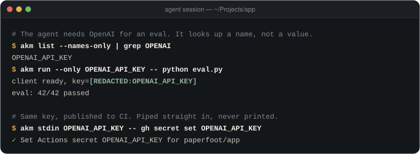
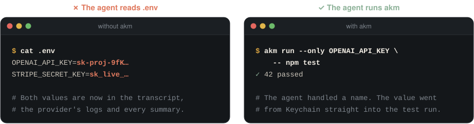
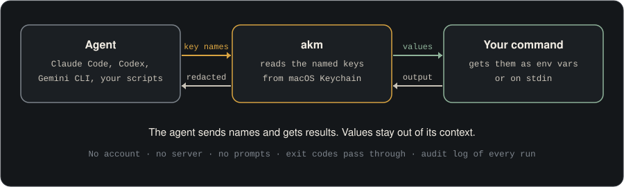

<p align="center">
  
</p>

<h1 align="center">akm</h1>

<p align="center">
  <b>Keychain secrets for AI agents.</b><br>
  Your agent runs the command. The key never enters the conversation.
</p>

<p align="center">
  <a href="https://github.com/paperfoot/api-key-manager/actions/workflows/ci.yml"></a>
  <a href="https://github.com/paperfoot/api-key-manager/releases/latest"></a>
  <a href="#install"></a>
  
  <a href="LICENSE"></a>
</p>

<p align="center">
  
</p>

Coding agents need API keys all day: to run tests, call models, deploy, and set CI secrets. The usual answer is a `.env` file the agent can read. Every key in it then lands in the transcript, the model provider's logs, and every summary after that.

AKM keeps your keys in the macOS Keychain you already have. The agent asks for a key **by name** and puts `akm run --only NAME --` in front of the command it was going to run anyway. AKM hands the value to that one process, scrubs it from the output, and passes the exit code back. No account, no server, no prompts.

```sh
brew install paperfoot/tap/akm
akm skill install    # teaches Claude Code, Codex and Gemini CLI to use it
```

## Why agents take to it

AKM was built with agents as its main user, and they pick it up without help:

- **Nothing new to learn.** It is a prefix on the command the agent already wrote. No SDK, config file, or daemon.
- **Names in, results out.** `akm list --names-only` shows what exists. Values stay in Keychain and in the one process that needs them.
- **It never hangs.** No password prompt, Touch ID, or Keychain dialog. When access is unavailable the agent gets an error with the fix, not a frozen job.
- **Made to be read by machines.** JSON when piped, errors on stderr with a suggested fix, meaningful exit codes, and the child's own exit code passed through untouched.
- **Cheap to discover.** `akm agent-info` lists every command on one line; `akm agent-info --command run` returns only that command. The bundled skill is about 1.5 KB.
- **It fits Claude Code's auto mode.** The built-in rules block printing a credential but allow "piping the credential directly into the consuming command so it never reaches stdout". That is what `akm run` and `akm stdin` do.

On the author's Mac, agents and the scripts they wrote called AKM about 19,000 times in the five weeks after 0.3.0 shipped, across 89 git repositories. In a sample of 595 agent tool calls, two had a syntax mistake, and both forms are valid now.

<p align="center">
  
</p>

## How it works

<p align="center">
  
</p>

Pick the transport the receiving command accepts:

| Need | Command |
|---|---|
| Environment variables | `akm run --only OPENAI_API_KEY,ANTHROPIC_API_KEY -- npm test` |
| Rename a key for one process | `akm run --only API_KEY=PROJECT_API_KEY -- python script.py` |
| The value on stdin | `akm stdin DEPLOY_TOKEN -- gh secret set DEPLOY_TOKEN` |
| `NAME=value` on stdin | `akm stdin TOKEN --format env -- flyctl secrets import` |
| Find a stored name | `akm list --names-only` |
| Check the setup | `akm doctor` |

`run` and `stdin` redact the exact supplied values from the child's stdout and stderr, including values split across reads, and stream ordinary output as it arrives. SIGINT, SIGTERM and SIGHUP reach the child's process group.

## Install

```sh
brew install paperfoot/tap/akm
akm skill install    # optional: instructions for Claude Code, Codex and Gemini CLI
akm doctor           # optional: confirm Keychain access, signature and skill
```

Homebrew installs a release signed with a stable Developer ID, so upgrades keep Keychain access. A source build works too (`cargo install api-key-manager --locked`, Rust 1.85+), but its signing identity is yours to keep stable. CI covers macOS 26 on Apple Silicon and macOS 15 on Intel.

After an upgrade, run `akm skill install` again to refresh the skill. `akm update` prints the right upgrade command for how AKM was installed.

## Add keys

Pass the value on stdin, from your shell or from the program that already holds it:

```sh
pbpaste | akm add OPENAI_API_KEY
akm import .env --dry-run    # preview names; reads no Keychain items
akm import .env              # copy literal values in; never runs substitutions or deletes the file
```

```python
subprocess.run(["akm", "add", "OPENAI_API_KEY"], input=value, text=True, check=True)
```

Names use `[A-Z_][A-Z0-9_]*`. `add` replaces an existing value and refuses a terminal as stdin, so it never waits for typing.

## Compared with

| | `.env` file | 1Password `op run` | **akm** |
|---|---|---|---|
| Keys sit in a plaintext file | Yes | No | **No** |
| Account or subscription | No | Yes | **No** |
| Prompts | None | Touch ID per terminal session, unless you use a service account | **None** |
| Output redaction | No | Yes | **Yes** |
| Pipe a value into a command's stdin | By hand | Through `op read` | **`akm stdin`** |
| Agent discovery and skill | No | MCP server and plugin | **`agent-info`, `skill install`** |

Choose something else when you need to share secrets with a team, run on Linux or in CI, or want a hosted audit trail: 1Password, Infisical, Doppler and fnox do that well. AKM is for one Mac and the agents working on it.

## Security model

AKM prevents accidental disclosure: keys in project files, shell history, `ps` output, git commits, build logs and agent transcripts.

It is not a sandbox. Any process running as you can read your keys, including an agent that sets out to; `get --raw` and `export` exist for backups. Redaction matches exact bytes, so an encoded or partial value passes through. Child environment variables are visible to same-user inspection.

If you want the agent to never hold a value at all, pair AKM with a credential-masking proxy. For Claude Code, mask the key in its [sandbox `credentials` setting](https://code.claude.com/docs/en/sandboxing) and start Claude with `akm run --no-redact --only GH_TOKEN -- claude`: sandboxed commands then see a placeholder, and the real value is added only on requests to the hosts you allow.

Every operation and child lifecycle is recorded in `~/.akm/audit.log` (mode `0600`) with names and metadata, never values or full child arguments. The log is best effort, writable by you, and not tamper-proof. The optional `akm guard install` pre-commit hook flags staged known key prefixes followed by token-like text; it is a heuristic, not a full scanner.

<details>
<summary><b>All commands</b></summary>

| Command | Behavior |
|---|---|
| `akm run --only NAMES -- CMD` | Run a command with keys as environment variables. `--all` selects every key; `--no-redact` hands the child the terminal directly. |
| `akm stdin NAME -- CMD` | Write one value to a command's stdin. `--format env` writes a shell-quoted `NAME=value`. |
| `akm add NAME` | Store a key from stdin; replaces an existing value. |
| `akm list` | List names. `--names-only` prints one per line; `--long` adds the last-write age from the audit log. |
| `akm get NAME` | Show a masked value. `--raw` shows the full value (still JSON when piped). |
| `akm rm NAME` | Remove a key; already absent succeeds. |
| `akm import FILE` | Import literal dotenv values. `--dry-run` previews without Keychain access. Not transactional. |
| `akm export` | Export raw values for backup (`--format env` or `json`, `--only` subset). Audit-logged. |
| `akm migrate --from PATH` | Copy keys from an older AKM executable; see [Upgrading from 0.1 or 0.2](#upgrading-from-01-or-02). |
| `akm doctor` | Check Keychain access, signature, legacy entries, skill and audit log. Read-only. |
| `akm update` | Print the upgrade command for this installation. |
| `akm audit --limit 50` | Show the latest audit records. |
| `akm guard install \| uninstall \| scan` | Manage the optional pre-commit key scan. Preserves existing hooks. |
| `akm skill install \| status` | Install or check the agent skill for Claude Code, Codex and Gemini CLI. |
| `akm agent-info [--command NAME]` | Machine-readable command list, or one command's full contract. |

</details>

<details>
<summary><b>Output contract</b></summary>

AKM follows the [agent-cli-framework](https://github.com/paperfoot/agent-cli-framework) contract.

- Piped stdout, or `--json`, is one JSON envelope: `{"version":"1","status":"success","data":...}`.
- Errors go to stderr as `{"version":"1","status":"error","error":{"code","message","suggestion"}}`, leaving stdout for data.
- `run` and `stdin` forward the child's output as is. `--json` adds a completion envelope on stderr after the child's own stderr.
- `agent-info` prints its manifest as raw JSON. `--help` and `--version` stay plain text; `--json --help` wraps the help in an envelope.
- Exit codes: `0` success, `1` runtime failure, `2` setup (for example Keychain unavailable), `3` bad input, `6` missing key. `run` and `stdin` return the child's code, or `128 + signal`.

</details>

<details>
<summary><b>Upgrading from 0.1 or 0.2</b></summary>

Older local builds were ad-hoc signed, and macOS ties Keychain access to that exact executable. Keep a copy of the working binary **before upgrading**:

```sh
mkdir -p ~/.akm/legacy
cp "$(command -v akm)" ~/.akm/legacy/akm-before-upgrade
brew upgrade akm
akm migrate --from ~/.akm/legacy/akm-before-upgrade --dry-run
akm migrate --from ~/.akm/legacy/akm-before-upgrade
akm skill install
```

Migration copies values through private pipes into `com.paperfoot.akm.v2`, verifies each write, skips existing entries, and keeps the old `com.paperfoot.akm` entries. Values never appear in its output or in temporary files. `--only NAME,NAME` selects a subset. It stops at the first source failure or five-second timeout and can be rerun. The older executable may show its own Keychain dialog; AKM cannot suppress another process's dialogs.

New entries take precedence and readable legacy entries remain a fallback. `rm` removes both copies so an old value cannot reappear. Do not remove the only binary that can read your keys before confirming its replacement works.

If AKM reports `keychain_unavailable`, keep `HOME` set to your real home directory and check that the Login Keychain is unlocked in Keychain Access. AKM never resets a keychain, changes its access controls, or turns off system prompts.

</details>

## Development

```sh
cargo fmt --check
cargo clippy --all-targets --all-features --locked -- -D warnings
cargo test --locked
python3 assets/terminals.py    # regenerate the README illustrations
```

Integration tests create and remove uniquely named synthetic Keychain entries and keep the real `HOME`. Release steps are in [docs/releasing.md](docs/releasing.md). The [September 2026 review](docs/review-2026-09-16.md) covers usage evidence and validation.

MIT. Built by [Paperfoot](https://paperfoot.com).
